# Figure gallery

Every figure here is a saved output of the code in this repository. Nothing is mocked up. The README shows a short selection; this page has the rest.

The FULL profile has the same set as FAST in [`reports/full/figures/`](../reports/full/figures/), and the public-data demo is in [`reports/demo_fred_energy/figures/`](../reports/demo_fred_energy/figures/). Detailed tables sit next to the figures in each `reports/<profile>/` folder.

## Return forecasting (FAST profile, 424 targets)

Out-of-sample results for the return models. Source: `reports/fast/figures/`.

**Equity volatility over time, with the low, mid and high volatility regimes used in the regime analysis.**

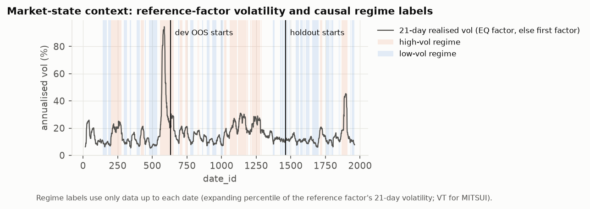

[`reports/fast/figures/01_regime_timeline.png`](../reports/fast/figures/01_regime_timeline.png)

**Rolling average rank correlation of each model, out of sample. The shaded area is the holdout.**

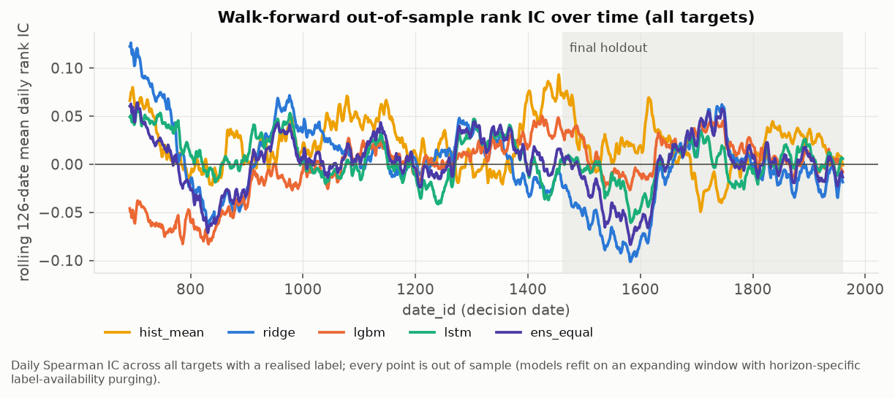

[`reports/fast/figures/02_ic_over_time.png`](../reports/fast/figures/02_ic_over_time.png)

**Mean rank correlation on the holdout for every model, with 95% confidence intervals. Hollow dots are the development period.**

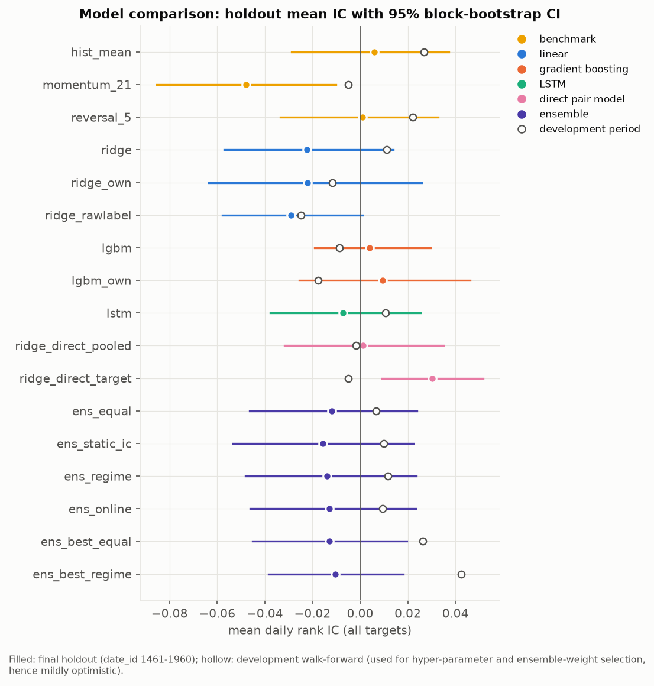

[`reports/fast/figures/03_model_comparison.png`](../reports/fast/figures/03_model_comparison.png)

**Accuracy and stability at each forecast horizon, 1 to 4 days.**

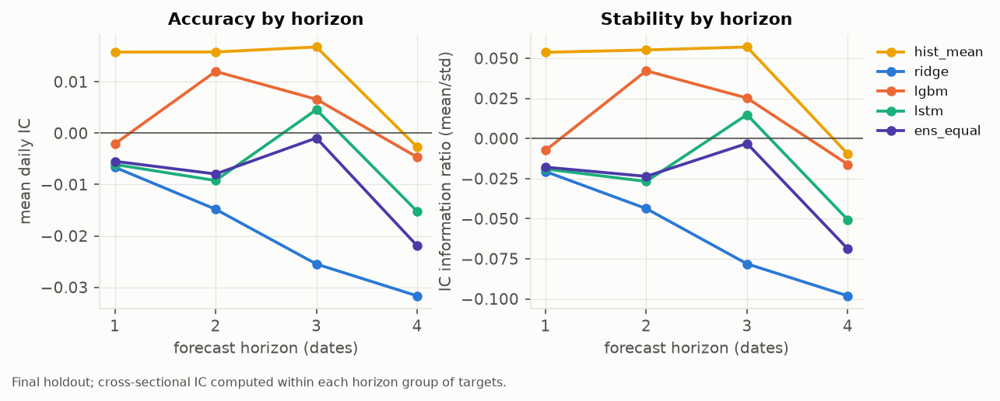

[`reports/fast/figures/04_by_horizon.png`](../reports/fast/figures/04_by_horizon.png)

**Accuracy by equity-volatility regime on the holdout.**

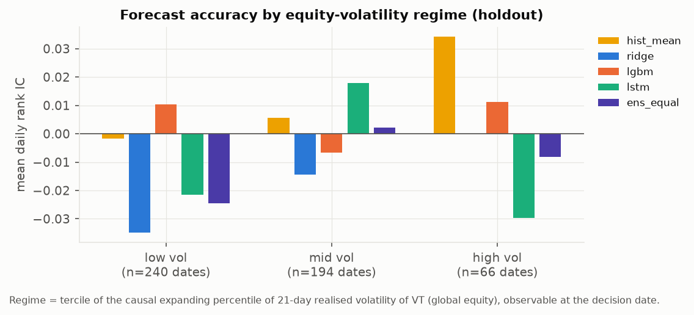

[`reports/fast/figures/05_vol_regimes_holdout.png`](../reports/fast/figures/05_vol_regimes_holdout.png)

**The same split using every out-of-sample date, which gives each regime more observations.**

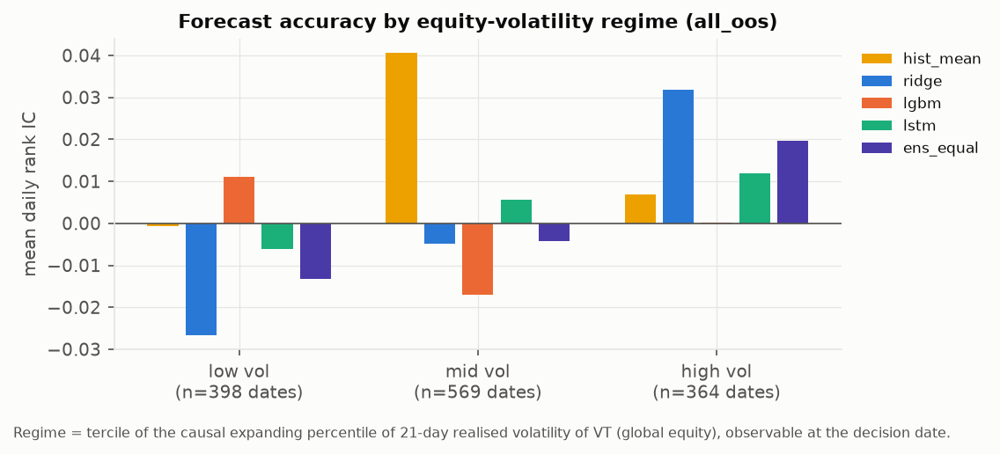

[`reports/fast/figures/05b_vol_regimes_all_oos.png`](../reports/fast/figures/05b_vol_regimes_all_oos.png)

**Does cross-asset information help? The same model with own-asset features only and with all features.**

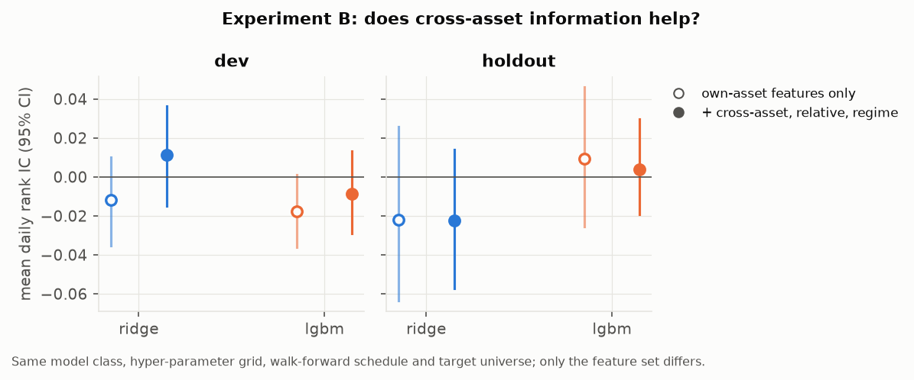

[`reports/fast/figures/06_cross_asset_ablation.png`](../reports/fast/figures/06_cross_asset_ablation.png)

**Model combinations against their members, and the weights the online ensemble chose over time.**

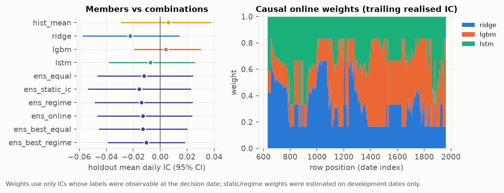

[`reports/fast/figures/07_ensembles.png`](../reports/fast/figures/07_ensembles.png)

**Prediction-interval coverage by volatility regime, and whether disagreement between models flags larger errors.**

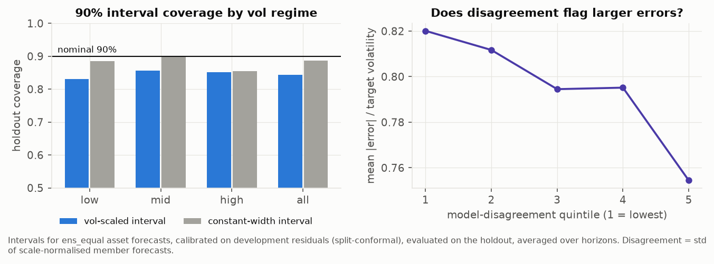

[`reports/fast/figures/08_uncertainty.png`](../reports/fast/figures/08_uncertainty.png)

**A hypothetical long-short portfolio on single assets. This is a paper diagnostic, not a tradable result: it ignores costs, financing and currency conversion.**

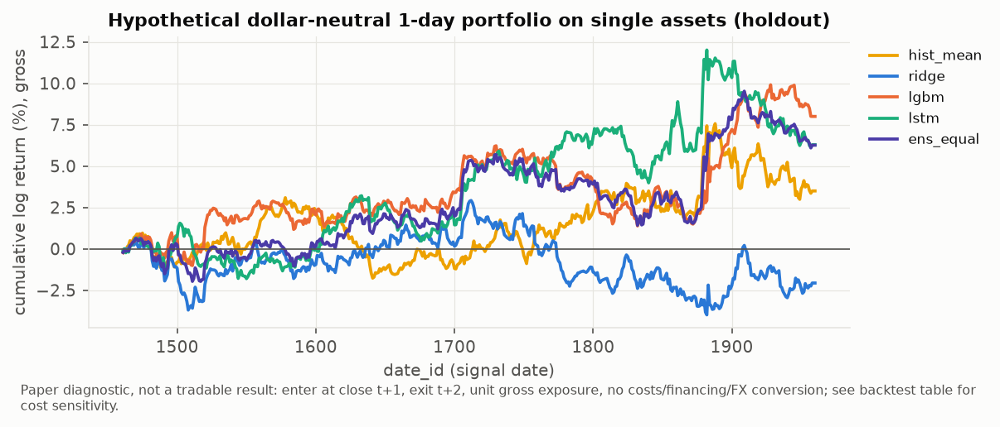

[`reports/fast/figures/09_backtest_hypothetical.png`](../reports/fast/figures/09_backtest_hypothetical.png)

**Which features Ridge and LightGBM lean on most.**

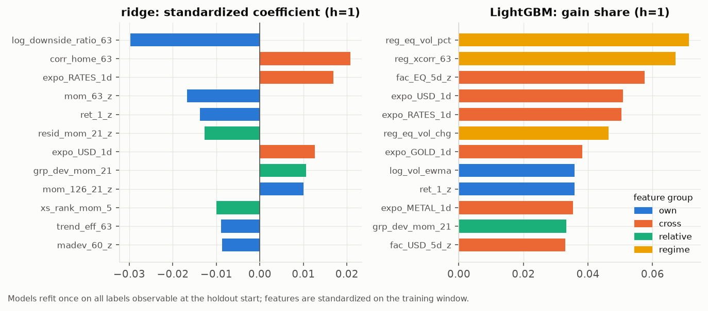

[`reports/fast/figures/10_feature_attribution.png`](../reports/fast/figures/10_feature_attribution.png)

## Financial econometrics

Stylised facts and model diagnostics. Source: `reports/vol/figures/`.

**Autocorrelation of returns and squared returns for four representative instruments.**

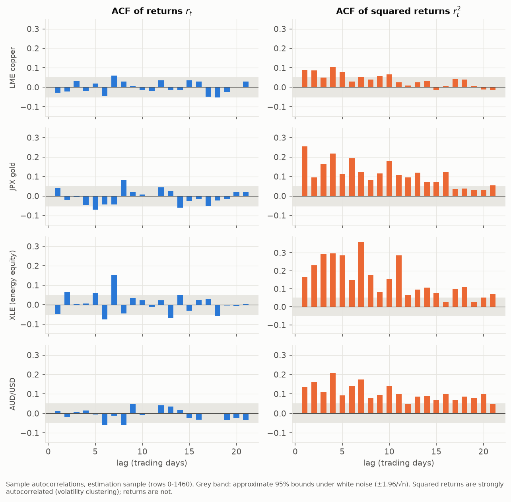

[`reports/vol/figures/v01_acf_returns_vs_squared.png`](../reports/vol/figures/v01_acf_returns_vs_squared.png)

**Q-Q plots of raw returns, GARCH residuals against the Normal, and GARCH residuals against the fitted Student-t.**

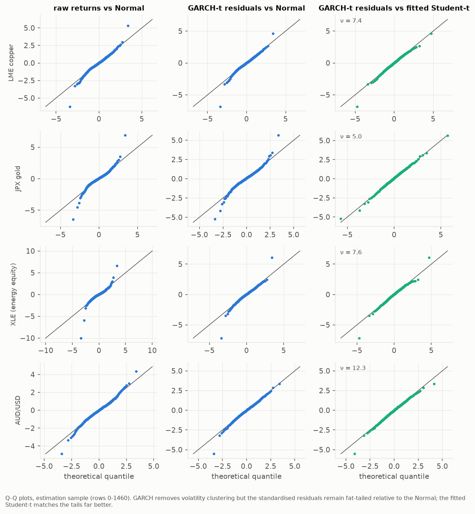

[`reports/vol/figures/v02_qq_plots.png`](../reports/vol/figures/v02_qq_plots.png)

**Share of instruments rejecting each diagnostic test, after correcting for testing many series at once.**

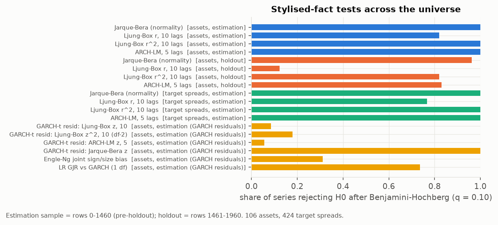

[`reports/vol/figures/v03_test_rejection_shares.png`](../reports/vol/figures/v03_test_rejection_shares.png)

## Volatility modeling

Out-of-sample volatility forecasts. Source: `reports/vol/figures/`.

**QLIKE of each volatility model relative to EWMA at 1, 5 and 21 days. Lower is better.**

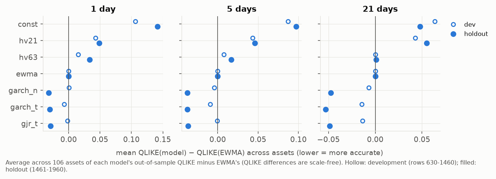

[`reports/vol/figures/v04_qlike_vs_ewma.png`](../reports/vol/figures/v04_qlike_vs_ewma.png)

**How often each model stays in the Model Confidence Set. High inclusion for many models reflects how noisy daily volatility proxies are.**

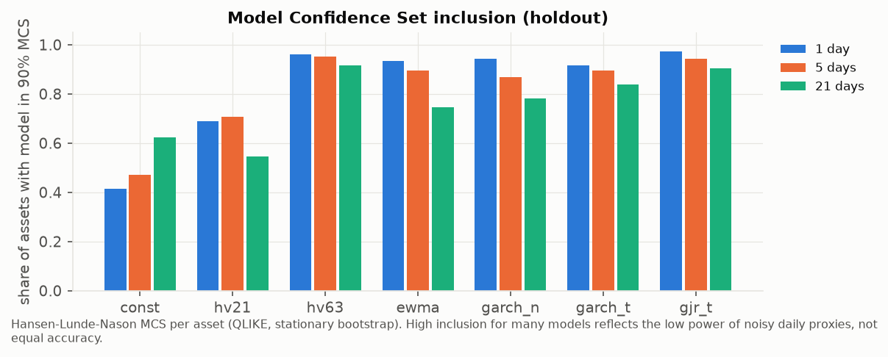

[`reports/vol/figures/v05_mcs_inclusion.png`](../reports/vol/figures/v05_mcs_inclusion.png)

**21-day volatility forecasts against realised volatility for LME copper and AUD/USD.**

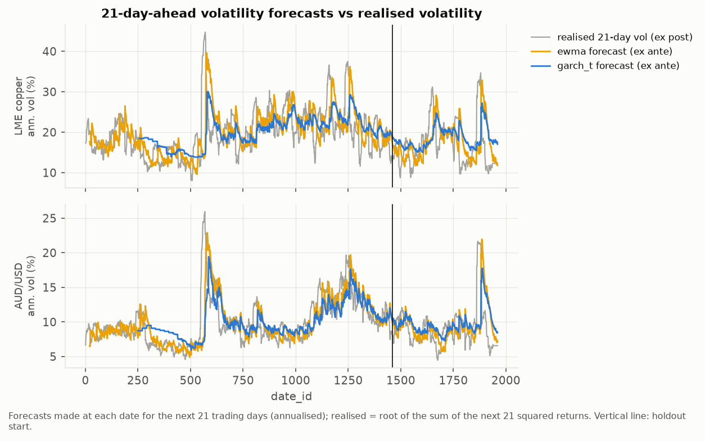

[`reports/vol/figures/v06_vol_forecast_paths.png`](../reports/vol/figures/v06_vol_forecast_paths.png)

## Volatility and return forecasts

Does volatility information help predict returns? Source: `reports/vol/figures/`.

**LightGBM and Ridge return models with different feature sets, on the development period and the holdout.**

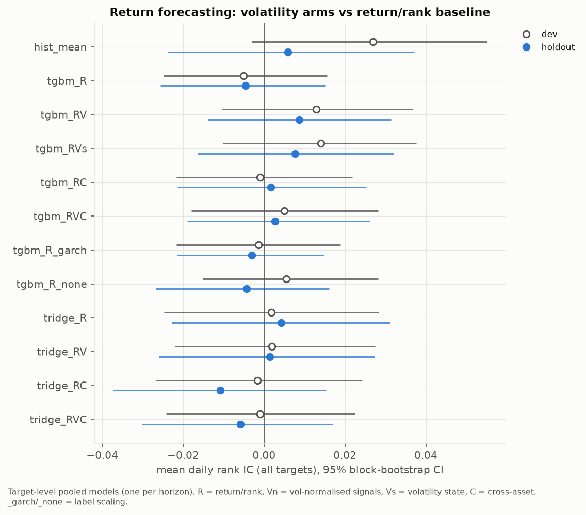

[`reports/vol/figures/v07_return_arms.png`](../reports/vol/figures/v07_return_arms.png)

**The gain from volatility features in low, mid and high market-volatility regimes.**

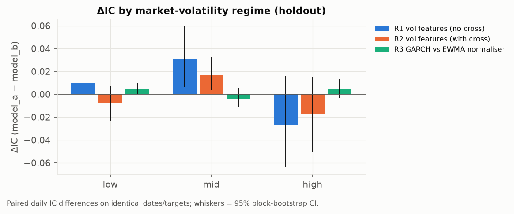

[`reports/vol/figures/v08_delta_by_market_vol.png`](../reports/vol/figures/v08_delta_by_market_vol.png)

**The same gain for low, mid and high volatility targets.**

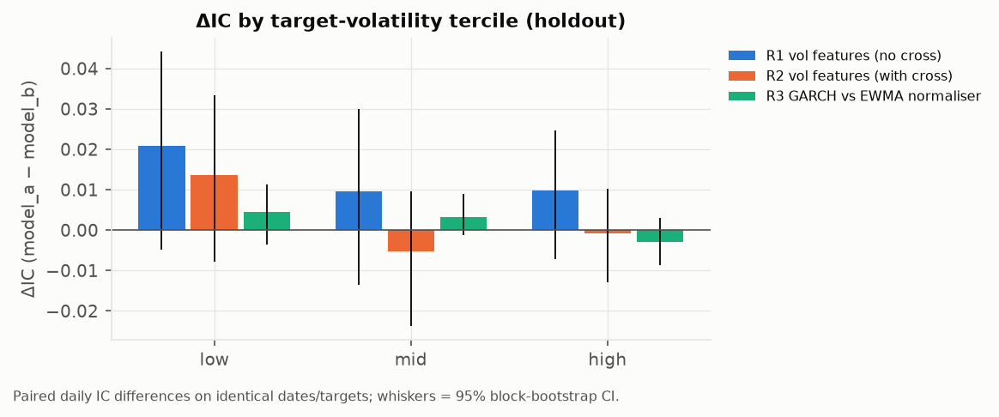

[`reports/vol/figures/v09_delta_by_target_vol.png`](../reports/vol/figures/v09_delta_by_target_vol.png)

**Rolling accuracy over time, with and without volatility information.**

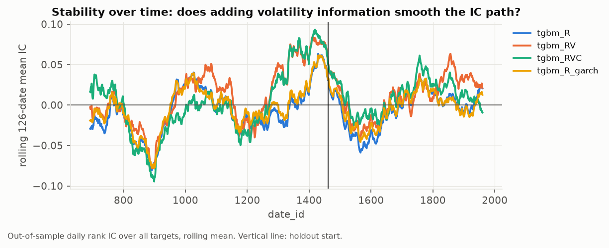

[`reports/vol/figures/v10_rolling_ic.png`](../reports/vol/figures/v10_rolling_ic.png)

**How much of the LightGBM model's splitting comes from each feature group.**

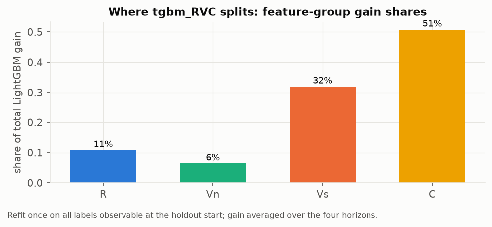

[`reports/vol/figures/v11_group_importance.png`](../reports/vol/figures/v11_group_importance.png)

## Robustness checks

The same return comparison under different training setups.

**Refitting every 42 dates and using a higher-capacity LightGBM. Source: `reports/vol_robust/`.**

[`reports/vol_robust/figures/v07_return_arms.png`](../reports/vol_robust/figures/v07_return_arms.png)

**A rolling 750-date training window instead of an expanding one. Source: `reports/vol_rolling/`.**

[`reports/vol_rolling/figures/v07_return_arms.png`](../reports/vol_rolling/figures/v07_return_arms.png)

**Exploratory (not pre-registered): market-level against target-level volatility state. Source: `reports/vol_explore/`.**

[`reports/vol_explore/figures/v07_return_arms.png`](../reports/vol_explore/figures/v07_return_arms.png)

## Replication on public energy data

The same pipeline on public FRED/EIA prices, with a held-out 2026 sample. Source: `reports/vol_fred/figures/`.

**Q-Q plots for oil, gas and the dollar index.**

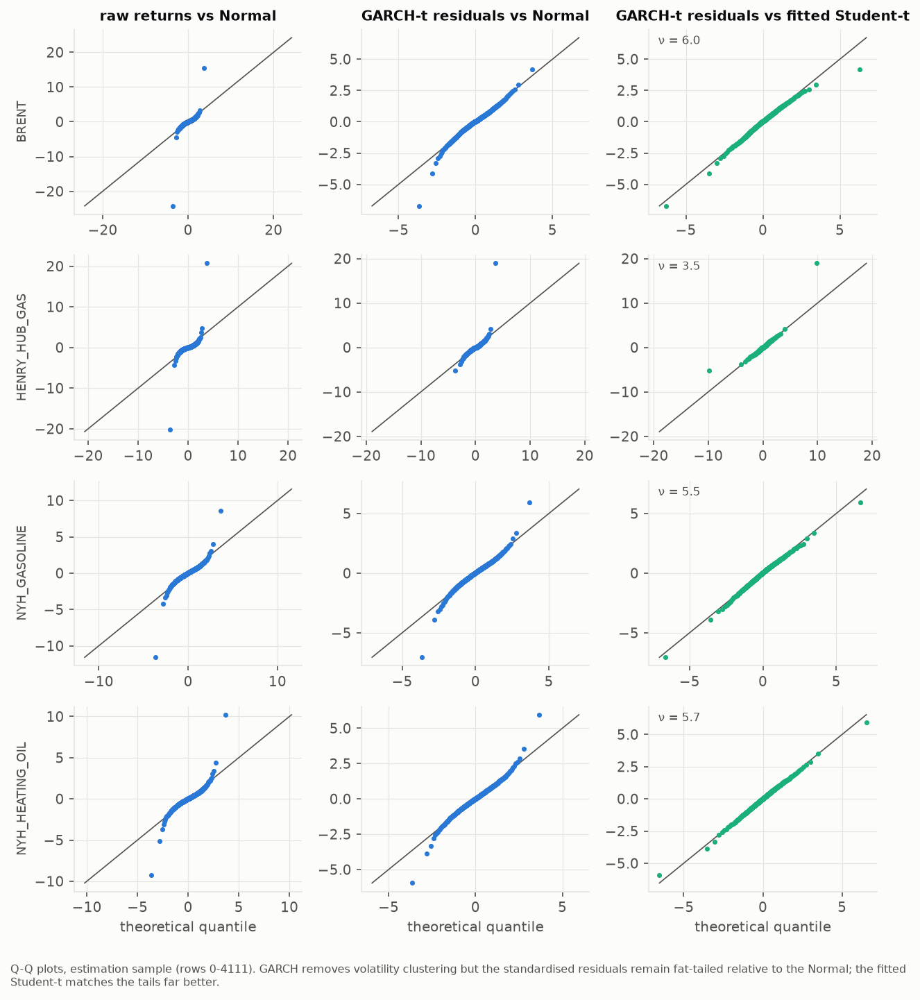

[`reports/vol_fred/figures/v02_qq_plots.png`](../reports/vol_fred/figures/v02_qq_plots.png)

**Volatility model accuracy relative to EWMA.**

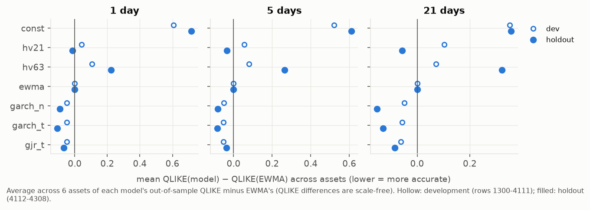

[`reports/vol_fred/figures/v04_qlike_vs_ewma.png`](../reports/vol_fred/figures/v04_qlike_vs_ewma.png)

**21-day forecasts against realised volatility for Brent and Henry Hub gas.**

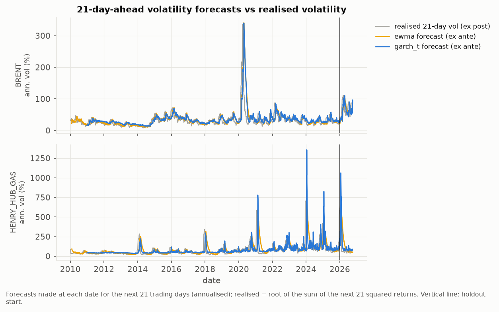

[`reports/vol_fred/figures/v06_vol_forecast_paths.png`](../reports/vol_fred/figures/v06_vol_forecast_paths.png)

**Return models with and without volatility information.**

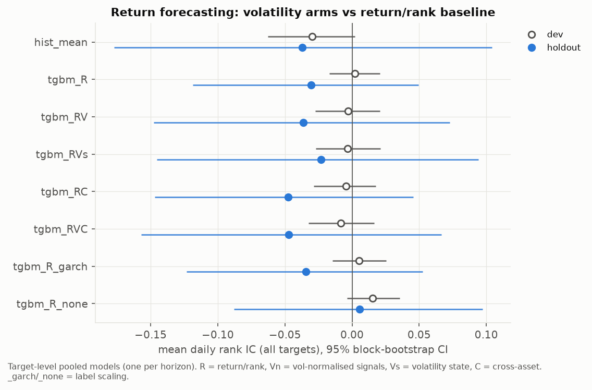

[`reports/vol_fred/figures/v07_return_arms.png`](../reports/vol_fred/figures/v07_return_arms.png)

## Also available

- [`reports/vol_fred/figures/`](../reports/vol_fred/figures/): all replication figures
- [`reports/vol_robust/figures/`](../reports/vol_robust/figures/), [`reports/vol_rolling/figures/`](../reports/vol_rolling/figures/), [`reports/vol_explore/figures/`](../reports/vol_explore/figures/): the other robustness panels (regime, target-volatility and rolling views)
- [`reports/full/figures/`](../reports/full/figures/) and [`reports/demo_fred_energy/figures/`](../reports/demo_fred_energy/figures/)
